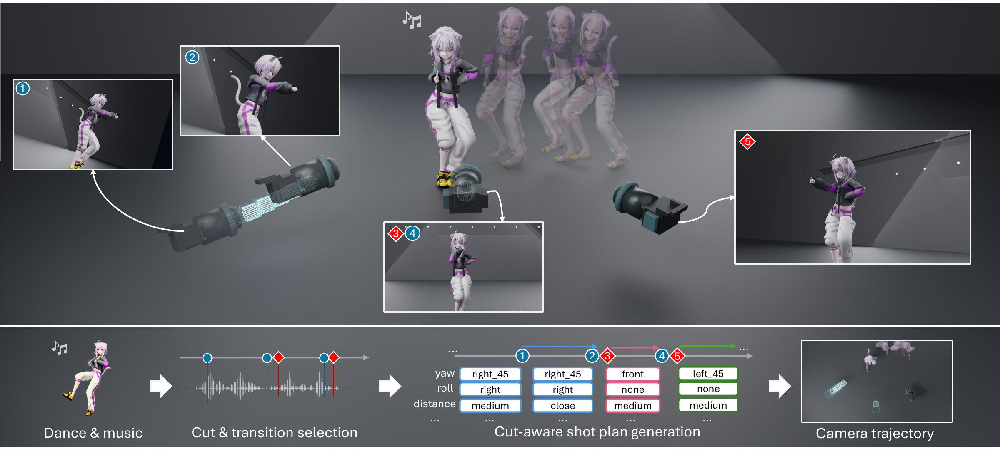

<div align="center">

# CuCaT: Cut-Structured Camera Trajectory Generation for Dance Music Videos

**SIGGRAPH Asia 2026 Conference Papers**

SooBin Lim<sup>1*</sup> · SeongRae Noh<sup>1*</sup> · Jeongyoun Kwon<sup>1</sup> · YoungBeom Kim<sup>2</sup> · HyeongYeop Kang<sup>1†</sup>

<sup>1</sup>IIIXR Lab, Korea University &nbsp; <sup>2</sup>Korea Electronics Technology Institute (KETI)<br>
<sub>* equal contribution &nbsp; † corresponding author</sub>

[Project page](https://dnpcs12.github.io/CuCaT-Page/) · [Paper](https://doi.org/10.1145/3829340.3842347) · [Checkpoints](https://drive.google.com/drive/folders/1uks6TbkBk5fZE7a3wPO6aunoG-T9zZSe)

</div>



CuCaT generates an MMD camera track for a dance performance from its music and motion. Instead of predicting one homogeneous stream of camera states, it places explicit **cut pairs** that renew the viewpoint and **transition keyframes** that shape smooth motion inside each shot. Every keyframe is described by a performer-relative **semantic shot plan** (target anchor, composition, distance, yaw, pitch, roll, FoV), which a deterministic solver turns into a standard MMD camera keyframe.

The pipeline has four stages:

1. **Cut-structured keyframe selection**: predict a keyframe budget, then select cut pairs and in-shot transition frames from music and dance features.
2. **Role-aware shot-plan generation**: a Transformer with separate cut and transition heads proposes top-K shot plans for every event.
3. **Trajectory optimization**: CP-SAT picks one candidate per event over the whole timeline, penalizing distance bounces, weak cuts, and zoom-like motion around cuts.
4. **Interpolation and MMD solve**: an MLP predicts the easing of each keyframe, and the solver writes the final camera `.vmd`.

## Contents

- [Installation](#installation)
- [Generate a camera](#generate-a-camera): run CuCaT on your own music and dance, from a local web demo or the command line
- [Reproducing the paper](#reproducing-the-paper): DCM data, evaluation, and training
- [Repository structure](#repository-structure)
- [Citation](#citation)

## Installation

The release has been tested on Windows 10/11. You need:

- **Python 3.11** (conda recommended). A CUDA GPU is optional; everything also runs on CPU.
- **ffmpeg and ffprobe** on `PATH`.
- **Visual Studio 2022 Build Tools** (*Desktop development with C++*) and **CMake 3.16+**, to build the SABA tools.
- An OpenGL-capable GPU driver, to render videos.

### 1. Python environment

From the repository root in PowerShell:

```powershell
conda create -n cucat python=3.11 -y
conda activate cucat
$env:PYTHONIOENCODING = 'utf-8'
pip install -r requirements.txt
```

For CUDA, install a CUDA-enabled PyTorch build that matches your driver. `madmom` is optional for [generating a camera](#generate-a-camera) (the pipeline falls back to librosa beat tracking), but it is required to build the DCM features for [evaluation](#evaluation) and [training](#training).

### 2. Checkpoints

Download **CuCaT_Model_Checkpoints.zip** from [Google Drive](https://drive.google.com/drive/folders/1uks6TbkBk5fZE7a3wPO6aunoG-T9zZSe) and extract it into the repository root so that the folder is named `final model/`:

```text
final model/
├── cut_transition/best_model.pt                 # stage 1: per-frame cut probability
├── density_stagea/best_model.pt                 # stage 1: keyframe budget (density)
├── keyframe_stage2/best_model.pt                # stage 1: cut-conditioned transition locator
├── v3_1_visual_scale_005/best.pt                # stage 2: shot-plan Transformer
├── v3_1_visual_scale_005/normalization_stats.npz
└── v3_1_interpolation_stage/best.pt             # stage 4: interpolation (easing) MLP
```

These are the final models of the paper. They are distributed only through Google Drive, and the pipeline finds them at the paths above.

### 3. SABA tools

SABA evaluates an MMD model and dance motion into body targets (`mmd_target_dump`) and renders videos (`saba_viewer`).

```powershell
powershell -ExecutionPolicy Bypass -File .\saba_mmd\build_windows.ps1
```

The executables are written to `saba_mmd/build/Release/`. See [`saba_mmd/README.md`](saba_mmd/README.md) for manual CMake commands and troubleshooting.

## Generate a camera

CuCaT needs a song (`.wav`), a dance motion (`.vmd`), and a PMX/PMD model whose skeleton matches the motion. No DCM data is required. No model, motion, or music is bundled with this repository; our renders use [Nekomata Okayu](https://3d.nicovideo.jp/works/td63648), which you can download separately (keep its textures next to the PMX and follow the model's terms of use).

You can run CuCaT from a local web page or from the command line. Both run the same pipeline with the same defaults.

### Web demo

```powershell
python -m music_processing.serve_unseen_mmd_pipeline
```

Open <http://127.0.0.1:8785/>, drop the WAV, the VMD, and the PMX/PMD, and press **Run pipeline**. To get a textured preview video, also choose the model's *Texture folder*. The server keeps every uploaded model with its textures in `music_processing/results/web_demo/models/` and the page selects the one used last, so later runs only need the WAV and the VMD. To try other settings on the same song, keep *Same as an earlier run* selected in the inputs card: nothing is uploaded again, and that run's motion conversion, Demucs stems, and beat tracking are reused when the files and their settings match (`--reuse-from` on the command line). Tick *Live 3D only, no MP4* next to **Run pipeline** to skip the SABA render while trying settings: the result plays in the browser, and *Render MP4* on the result card makes the video later. The cut selection, the cut ratio, and the keyframe budget sit right below the inputs; every advanced option explains itself when you hover its *i* icon. The page tracks each stage, plays the preview when it is ready, and offers the camera VMD for download. A finished run can also be opened in:

- **Edit tab**: a video-editor view with one timeline track per shot-plan field. Change the labels of any keyframe, add or delete keyframes and cuts, and the *Live 3D* view shows the new camera at once: the browser plays the run's model and dance with three.js (loaded from jsDelivr, so it needs an internet connection) while the server re-solves the camera. *Save & render* exports the camera VMD and renders the MP4 with SABA; each save is kept as a new version next to the original output.
- **Pipeline debug viewer**: stems, beats, cut and transition probabilities, and the shot plan before and after CP-SAT, all synced to the video.

The server listens on `127.0.0.1` by default. It reads local paths typed into the page and serves files from the repository folder, so do not expose it to a network. Start it with `--default-model-path <model.pmx>` to make the model upload optional.

### Command line

Put **one `.wav`** and **one dance `.vmd`** in a folder, then run:

```powershell
python -m music_processing.run_unseen_mmd_timing_pipeline `
  "D:/path/to/input_song" `
  --model-path "D:/path/to/your_model/your_model.pmx" `
  --render-model-path "D:/path/to/your_model/your_model.pmx" `
  --device cpu `
  --demucs-device cpu
```

- Use `--device cuda --demucs-device cuda` on a GPU machine.
- Add `--skip-render-preview` to stop after writing the camera VMD, without rendering a video.
- `--model-path` evaluates the dance; `--render-model-path` is only used for the video and can be a different, textured model.

### Outputs

Command-line results go to `music_processing/results/unseen_mmd_pipeline/<song_id>/`, where `<song_id>` is the input folder name (or `--song-id`). Web demo runs go to `music_processing/results/web_demo/outputs/`. In both, `summary.json` lists:

| Key | Content |
|---|---|
| `camera_vmd` | **Final camera VMD.** Load it in MMD together with the dance motion. |
| `preview_video` | Rendered MP4, unless `--skip-render-preview` was set. |
| `shot_plan_json` | Final shot plan: one semantic plan per keyframe, with its role (`cut` / `keyframe`) and easing. |
| `final_cut_key_timings` | Selected cut pairs and transition frames. |

### Options

Run the pipeline with `--help` for the full list. The web demo shows the same options under *Advanced options*.

| Option | Purpose |
|---|---|
| `--wav`, `--vmd` | Choose files explicitly instead of auto-detecting them in the input folder. |
| `--density-cut-percent`, `--cut-selection-mode`, `--cut-min-gap-sec`, `--cut-min-score` | How much of the keyframe budget goes to cuts, how cuts are placed, the minimum gap between cuts, and the minimum cut score. Defaults follow the paper: `70`, `global`, `1.0`, `0.0`. |
| `--skip-optimization` | Skip CP-SAT and keep the shot-plan model's direct predictions. |
| `--skip-interpolation` | Skip the easing model; every keyframe then uses linear interpolation. |
| `--optimization-*` | Weights and thresholds of the CP-SAT penalties. |
| `--force` | Recompute cached intermediate files. |

<details>
<summary><b>Running without the SABA tools</b></summary>

SABA is used to evaluate the dance into two files under `<output>/<song_id>/intermediate/`:

- `<song_id>_GlobalTransform.json`: global bone transforms, used for the dance features.
- `<song_id>_target_probe.json`: per-frame body targets, used to solve shot plans into the camera VMD.

If you already have both, pass the first with `--motion-json`, copy the second to `music_processing/results/unseen_mmd_pipeline/<song_id>/intermediate/<song_id>_target_probe.json`, and keep a `.vmd` in the input folder (or pass `--vmd`); it is looked up but not evaluated. Without a target probe the pipeline still writes the shot plan, but not the camera VMD. Video rendering always needs `saba_viewer`.

</details>

## Reproducing the paper

Everything in this section uses DCM. The checkpoints from [Installation](#2-checkpoints) are the paper's final models, and [`configs/`](configs) holds the exact arguments they were trained with.

### Data

> [!IMPORTANT]
> This repository does not redistribute DCM. Please obtain the original DCM data through the official [DCM / DanceCamera3D repository](https://github.com/Carmenw1203/DanceCamera3D-Official#download-dcm-dataset), and follow its license and preprocessing instructions there.

**DCM.** Put the DCM data folder at `local_assets/` in the repository root:

```text
local_assets/
├── amc_raw_data/                      # per-song raw MMD data (wav, dance VMD, camera VMD)
├── Simplified_MotionGlobalTransform/  # dance global transforms
├── split/                             # official DCM train / validation / test clip split
└── LinkOfRawData.xlsx                 # song index -> raw data mapping
```

**DCM++.** Our metrics use the DCM++ data prepared by [DanceCamAnimator](https://github.com/Carmenw1203/DanceCamAnimator-Official). In that repository, run the commands below, then place the resulting `DCM++` folder at `local_assets/DCM++`:

```bash
bash sh/data_preprocess.sh
bash sh/make_dcm_plusplus.sh
```

**Training labels.** Download **CuCaT_Training_Labels.zip** from [Google Drive](https://drive.google.com/drive/folders/1uks6TbkBk5fZE7a3wPO6aunoG-T9zZSe) and extract it into the repository root. It holds the exact labels used for the paper: V3.1 shot-plan labels for all 432 DCM clips (with and without the easing label), the clip split of the shot-plan models, and the per-song ground-truth cut frames and camera keyframes. They can also be [regenerated](#regenerating-the-training-labels) from the ground-truth cameras.

**Body targets.** Solving shot plans into DCM cameras, and regenerating the labels, needs per-frame body targets for every song. Download **CuCaT_Target_Dumps.zip** from [Google Drive](https://drive.google.com/drive/folders/1uks6TbkBk5fZE7a3wPO6aunoG-T9zZSe) and extract it into the repository root (`camera_autoshot/reverses/`). These are the targets used for the paper, extracted with the per-song character models listed in [`datasets/dcm_target_models.csv`](datasets/dcm_target_models.csv). If you have those models in `local_assets/target_models/`, `python -m camera_autoshot.dump_target_data --index <i> --paper-targets` regenerates the same targets. Other models give different camera geometry and different metric values.

### Evaluation

The DCM metrics (FID<sub>k</sub>, Dist<sub>k</sub>, FID<sub>s</sub>, Dist<sub>s</sub>, DMR, LCD) are computed with [DanceCamAnimator](https://github.com/Carmenw1203/DanceCamAnimator-Official)'s evaluation code on the 42 DCM test clips listed in [`datasets/dcm_test_clips.json`](datasets/dcm_test_clips.json).

**Setup.** Clone DanceCamAnimator, create its Python environment (we used Python 3.10, NumPy 1.23.5, SciPy 1.10.1), build DCM++ as described in [Data](#data), and apply the fixes our evaluation uses:

```powershell
git clone https://github.com/Carmenw1203/DanceCamAnimator-Official D:/path/to/DanceCamAnimator-Official
python -m evaluation.patch_dca --dca-root D:/path/to/DanceCamAnimator-Official
```

The fixes read files as UTF-8, replace `np.int` (removed in NumPy 1.24), trim each clip to the shortest of its camera, motion, and bone-mask lengths, save the metrics as floats, and fix the camera VMD reader.

**Generate and evaluate the test cameras.** `evaluation.run_dcm_test` runs the released models on the test clips and evaluates the cameras: it predicts the cuts and transitions of each test song from the clips' music and dance (`evaluation.dcm_test_timing`), predicts the shot plans (`evaluation.dcm_test_plans`), adds the easing, solves the camera VMDs with the body targets, and computes the metrics.

```powershell
python -m evaluation.run_dcm_test `
  --output-root evaluation/results/cucat `
  --dca-root "D:/path/to/DanceCamAnimator-Official" `
  --dca-python "D:/path/to/dca-env/python.exe"
```

- It needs the checkpoints, the body targets, DCM++ (see [Data](#data)), and the DCM clip features in `music_processing/results/cut_keyframe_multimodal_dataset_dcm`. To build the features, run the [stage-1 training steps](#training) up to `build_multimodal_dataset_split_variants`.
- `--timing-root <folder>` skips stage 1 and reads `cut_key_timings_by_song.json` from that folder instead, for example the `timing/` folder of an earlier run.
- Add `--cp-sat` to choose among the top-10 shot-plan candidates with CP-SAT before the easing. CP-SAT can return a different one of several equally optimal solutions from run to run, which moves FID<sub>k</sub> by up to about 0.02.

### Training

All commands run from the repository root. `configs/train_from_config.py` starts a training run with the stored arguments of a released checkpoint; options added after the config path override them. The configs train on CUDA; add `--device cpu` after the config path to train on CPU. W&B logging is off in every config; to turn it on, put your API key in `music_processing/.wandb_api_key` (git-ignored) and set `disable_wandb` to `false` in the config.

**Timing models (stage 1)**

```powershell
# Index DCM and render the ground-truth videos; the dataset builders read each song's frame grid from them.
# Any PMX/PMD model works. A dome and floor grid are added if local_assets/dome12.pmx and grid.pmx exist.
python saba_mmd/build/Release/batch_render_gt_range.py --start 0 --end 107 `
  --model-path "D:/path/to/your_model/your_model.pmx"

# Ground-truth cut frames and camera keyframes (also included in the training labels)
python -m camera_autoshot.analyze_gt_cuts
python -m camera_autoshot.analyze_gt_keyframes

# Music stems, then per-song music features and cut labels
foreach ($i in 0..107) { python -m music_processing.separate_stems_demucs --index $i }
python -m music_processing.build_cut_transition_dataset --start 0 --end 107

# Add dance features, then cut the songs into the official DCM clips
python -m music_processing.build_multimodal_cut_keyframe_dataset --start 0 --end 107 `
  --keyframe-labels camera_autoshot/analysis/gt_keyframes/gt_keyframes_per_song.json
python -m music_processing.build_multimodal_dataset_split_variants

# Training datasets for the three timing models
python -m music_processing.build_cut_feature_keyframe_datasets `
  --source-root music_processing/results/cut_keyframe_multimodal_dataset_dcm
python -m music_processing.build_audio_only_cut_dataset_from_multimodal `
  --source-root music_processing/results/cut_keyframe_multimodal_dataset_dcm `
  --feature-set audio_demucs_events_no_rms_compact_dance
python -m music_processing.build_keyframe_density_stagea_dataset `
  --source-root music_processing/results/01_datasets/cut_keyframe_multimodal_dataset_dcm_demucs_no_rms_compact_dance `
  --output-root music_processing/results/01_datasets/keyframe_density_stagea_dataset_dcm_demucs_no_rms_compact_dance_all_keyframes_trainval_no_c47_c105 `
  --exclude-song-ids c47,c105 --exclude-scope train_val --keep-cut-keyframe-pairs --include-tail-window
python -m music_processing.build_cut_conditioned_keyframe_dataset `
  --source-dataset-root music_processing/results/01_datasets/cut_keyframe_multimodal_dataset_dcm_demucs_no_rms_compact_dance `
  --output-root music_processing/results/01_datasets/cut_conditioned_keyframe_dataset_dcm_audio17_compact_dance

# Train
python configs/train_from_config.py configs/cut_transition.json
python configs/train_from_config.py configs/density_stagea.json
python configs/train_from_config.py configs/keyframe_stage2.json
```

**Shot-plan and interpolation models (stages 2 and 4)**

These use the training labels and the DCM clip features built above (`cut_keyframe_multimodal_dataset_dcm`).

```powershell
$common = @(
  "--feature-root", "music_processing/results/cut_keyframe_multimodal_dataset_dcm/songs",
  "--split-manifest", "shotplan_transformer/results/dcm_clip_split_manifest_v3_1_close_dense_temporal_delta.json",
  "--label-filename", "camera_poses_v3.json",
  "--sample-fps", "30", "--timeline-fps", "30", "--window-radius", "24",
  "--prev-context-size", "8", "--dance-feature-set", "compact")

python -m shotplan_transformer.build_dataset @common --label-fields v3 `
  --label-root camera_autoshot/reverse_v3/dcm_clip_labels/v3_1_close_dense_temporal_delta `
  --output-root shotplan_transformer/results/discrete_v3_1_30fps_close_dense_temporal_delta_dcm_split_dataset
python -m shotplan_transformer.build_dataset @common --label-fields v3_interpolation `
  --label-root camera_autoshot/reverse_v3/dcm_clip_labels/v3_1_close_dense_temporal_delta_with_interp `
  --output-root shotplan_transformer/results/discrete_v3_1_30fps_close_dense_temporal_delta_interp_dcm_split_dataset

python configs/train_from_config.py configs/shotplan_v3_1.json
python configs/train_from_config.py configs/interpolation_v3_1.json
```

#### Regenerating the training labels

<details>
<summary>Derive the shot-plan and easing labels from the DCM ground-truth cameras instead of downloading them</summary>

Run after the first three steps of stage 1 (the ground-truth render, `analyze_gt_cuts`, and `analyze_gt_keyframes`):

```powershell
# 1. Body targets for every song: extract CuCaT_Target_Dumps.zip (see Data), or regenerate them
#    with the paper's character models in local_assets/target_models/
Import-Csv datasets/dcm_target_models.csv | ForEach-Object {
  python -m camera_autoshot.dump_target_data --index $_.index --paper-targets
}

# 2. Simplified ground-truth cameras for seven songs whose original cameras are keyframed on every frame
python -m camera_autoshot.minimize_noncut_camera_keyframes --indices 14 19 47 49 100 104 105 `
  --fit-mode linear-sampled --write-vmd `
  --output-root camera_autoshot/analysis/minimal_noncut_camera_keyframes_linear_reduction60plus_vmd

# 3. Reverse every ground-truth camera into V3.1 shot plans, then cut them into DCM clips
python -m camera_autoshot.reverse_v3.run_v31_reverse --start 0 --end 107
python -m shotplan_transformer.build_dcm_v3_clip_labels `
  --dcm-manifest music_processing/results/cut_keyframe_multimodal_dataset_dcm/manifest.json
```

Song indices without DCM data are skipped. The regenerated clip labels already include the easing label, which is read from the ground-truth VMD Bezier curves, so use `camera_autoshot/reverse_v3/dcm_clip_labels/v3_1_close_dense_temporal_delta` as `--label-root` for both shot-plan datasets.

</details>

## Repository structure

```text
music_processing/       stage 1: audio/dance features, cut and keyframe timing, end-to-end pipeline entry point
shotplan_transformer/   stages 2-4: shot-plan Transformer, CP-SAT optimization, interpolation stage
camera_autoshot/        shot-plan schema, shot-plan <-> MMD camera solver, VMD I/O, label extraction
saba_mmd/               minimal SABA source for target extraction and rendering
configs/                training arguments of every released checkpoint, and train_from_config.py
evaluation/             DCM test-set inference and DanceCamAnimator metrics
datasets/               split files, the DCM test clip list, and the per-song body-target models
final model/            checkpoints (download from Google Drive, not tracked in Git)
local_assets/           DCM data and MMD models you provide (not tracked in Git)
```

## Citation

```bibtex
@inproceedings{lim2026cucat,
  title     = {CuCaT: Cut-Structured Camera Trajectory Generation for Dance Music Videos},
  author    = {Lim, SooBin and Noh, SeongRae and Kwon, Jeongyoun and Kim, YoungBeom and Kang, HyeongYeop},
  booktitle = {SIGGRAPH Asia 2026 Conference Papers (SA Conference Papers '26)},
  year      = {2026},
  publisher = {ACM},
  address   = {Kuala Lumpur, Malaysia},
  doi       = {10.1145/3829340.3842347}
}
```

## Acknowledgments

We thank the authors and contributors of:

- [SABA](https://github.com/benikabocha/saba): the MMD loading and rendering framework behind our modified `saba_mmd` tools.
- [DCM / DanceCamera3D](https://github.com/Carmenw1203/DanceCamera3D-Official): the dance-camera-music dataset and evaluation methodology.
- [DanceCamAnimator](https://github.com/Carmenw1203/DanceCamAnimator-Official): dataset preparation and camera evaluation code.

This research was supported by the Korea Creative Content Agency (RS-2026-25525030) and IITP grants funded by the Korea government (MSIT) (IITP-2026-RS-2020-II201819, IITP-2026-RS-2026-25615490).

## License

The CuCaT code is released under the [MIT License](LICENSE). SABA's original [MIT license](saba_mmd/LICENCE) and [third-party notices](saba_mmd/THIRD_PARTY.md) are retained. The DCM dataset, MMD models, motions, and music remain subject to their own terms.
